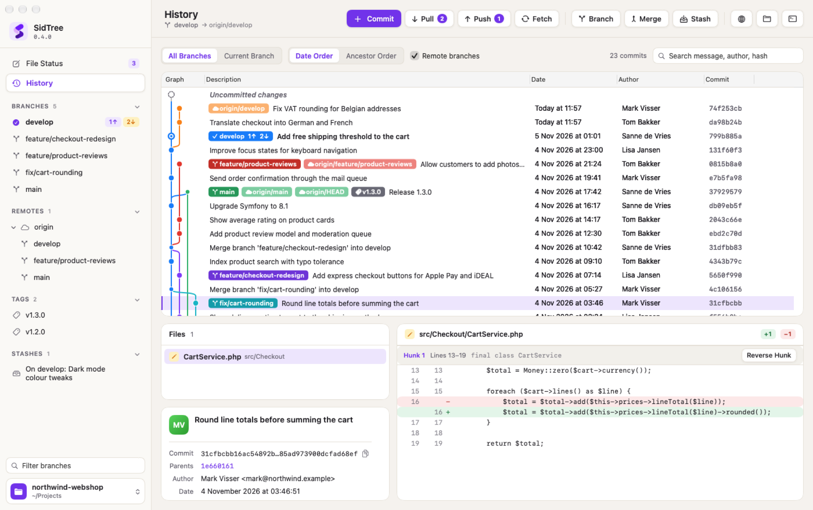
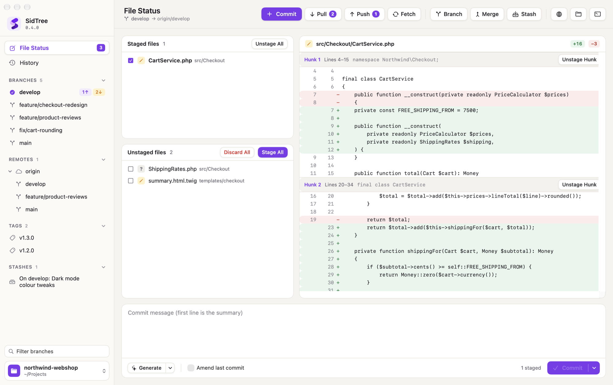
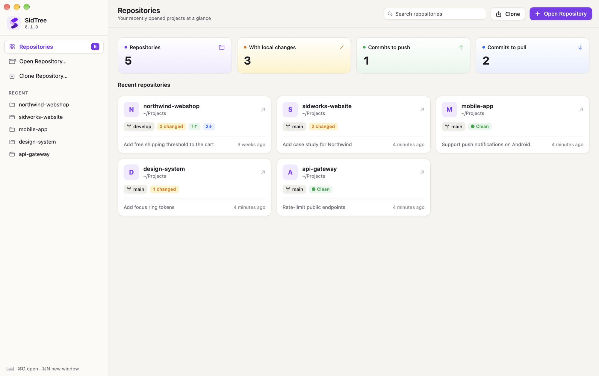
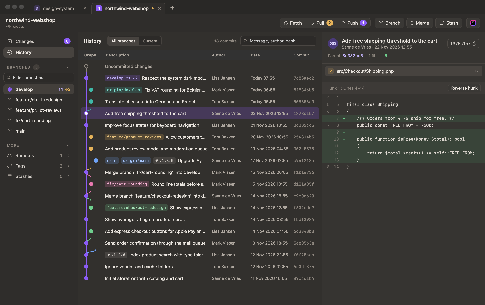

<div align="center">


# SidTree

**The Git client for macOS that is built for speed.**

History, staging, branches, pull and push, without the waiting.<br>
Native, instant on large repositories and easy on the eyes.

[](#install)
[](#install)
[](#building-from-source)

[Why](#why-sidtree) · [Speed](#built-for-speed) · [Features](#what-you-get) · [Install](#install) · [AI commit messages](#ai-commit-messages) · [Updates](#updates) · [Shortcuts](#keyboard-shortcuts)

</div>

<br>



## Why SidTree?

A Git client is something you look at all day, so every pause adds up: opening a repository, switching branches, waiting for a diff. SidTree is designed around performance first. It opens a repository with tens of thousands of commits in a fraction of a second, keeps up with your editor while you work, and puts the actions you use every day one click away.

It is a native Mac app that talks to the Git already installed on your Mac. No account, no background service, nothing to configure.

## Built for speed

Measured on an Apple Silicon Mac with a repository of 40,000 commits:

| | |
| --- | --- |
| History on screen after opening | **~0.1 s** |
| Reading 40,000 commits | **~15 ms** |
| Drawing the commit graph | **~20 ms** |
| Staging a file | **instant**, confirmed by Git in the background |

How it stays fast:

- **Native, not a web view.** SwiftUI and AppKit, with the history list drawn directly for smooth scrolling through thousands of commits.
- **First things first.** The newest commits appear immediately; the rest of the history, branches and status follow in parallel.
- **No unnecessary work.** Nothing is redrawn when nothing changed, and files written to ignored folders such as caches and build output never trigger a refresh.
- **Lets Git do less.** SidTree maintains Git's own commit index, which makes the history of large repositories load up to 10× faster.

## What you get

- **History with a graph.** Every branch, merge and tag at a glance, with authors, dates, hashes and ahead/behind counts.
- **Staging that stays out of the way.** Tick files to stage them, or stage, unstage and discard single hunks right from the diff.
- **The everyday actions.** Commit, pull, push to any remote branch, fetch, branch, merge, rebase, stash and tag.
- **AI commit messages.** One click writes a clear commit message from your staged changes, with Claude Code or Codex.
- **Calm conflict handling.** A clear banner while a merge or rebase is in progress, with resolve, continue and abort.
- **Always up to date.** Changes from your editor or terminal show up by themselves.
- **Light and dark.** A warm light theme and a dark theme, or follow macOS.



_File status: stage whole files or single hunks, then commit._



_The start screen shows every recent repository with its branch, local changes and what is waiting to be pushed or pulled._



## Install

1. Download `SidTree-x.y.z.zip` from the latest [release](https://github.com/sidworks-dev/sidtree/releases).
2. Unzip it and drag **SidTree** into your **Applications** folder.
3. Open it. The first time, macOS asks whether you trust the app: open **System Settings → Privacy & Security** and choose **Open Anyway**.

Open a repository with **File → Open** (⌘O), pick one from the start screen, or drop a folder on the app icon.

## AI commit messages

SidTree can write the commit message for you with **Claude Code** or **Codex**, if one of them is installed and logged in on your Mac. Turn it on in **Settings → AI**, then press **Generate** next to the commit box.

- It uses fast models by default (Claude Haiku, or the fastest Codex model on your account).
- Only a compact version of the staged changes is sent, to keep it quick and cheap.
- The instruction is yours to edit; a short default writes one clear line, like _Strip template inspector markers from HTML fragments_.
- Off by default. Nothing is sent anywhere until you switch it on.

## Updates

SidTree checks for new versions by itself and shows a small badge when one is available. **SidTree → Check for Updates…** installs it and relaunches. After an update, **What's New** lists the changes.

Because this repository is private, updates use your GitHub login through the [GitHub CLI](https://cli.github.com): run `gh auth login` once.

## Keyboard shortcuts

| Action | Shortcut |
| --- | --- |
| Open repository | ⌘O |
| File status / history | ⌘1 / ⌘2 |
| Commit | ⇧⌘C, then ⌘↩ to confirm |
| Generate commit message | ⌥⌘G |
| Pull / push / fetch | ⇧⌘L / ⇧⌘P / ⇧⌘F |
| Branch / merge / stash | ⇧⌘B / ⇧⌘M / ⇧⌘S |
| Refresh | ⌘R |

## Requirements

- macOS 14 Sonoma or later, on Apple Silicon or Intel
- Git (included with the Xcode Command Line Tools, or from Homebrew)

## Building from source

```sh
./scripts/build.sh    # creates build/SidTree.app
```

Only the Xcode Command Line Tools are needed. Releases are built by GitHub Actions from a version tag; see `scripts/release.sh` and [CHANGELOG.md](CHANGELOG.md).

## Credits

Built with ❤️ by [Sidworks](https://sidworks.nl).
